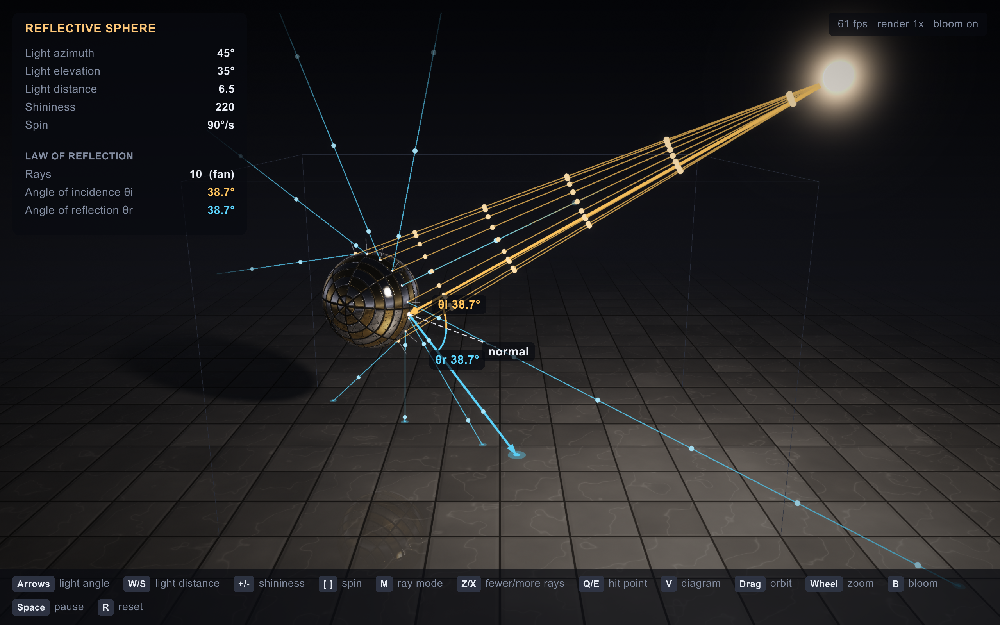
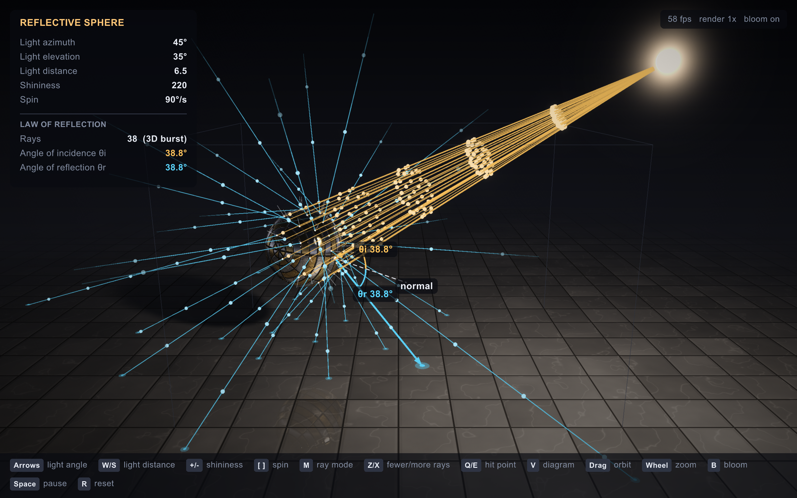

# Reflective Sphere (C#)

A 3D mirror-polished sphere that moves in x, y and z (bouncing inside a box), spins on its own
tilted axis, and reflects a glowing point light (a warm bulb) and its surroundings. A live diagram
shows the **law of reflection** on the sphere: the incident ray, the surface normal, the reflected
ray, and the angles of incidence and reflection, which stay equal however you move things.

Built with .NET 8 and [Raylib-cs](https://github.com/ChrisDill/Raylib-cs) (OpenGL 3.3+).

## Run

```bash
dotnet run
```

## Controls

| Key            | Action                                   |
|----------------|------------------------------------------|
| Left / Right   | Rotate light azimuth (around Y axis)     |
| Up / Down      | Raise / lower light elevation            |
| W / S          | Move the light closer / further          |
| + / -          | Shininess (tighter / broader highlight)  |
| [ / ]          | Spin speed                               |
| Mouse drag     | Orbit camera                             |
| Mouse wheel    | Zoom                                     |
| M              | Ray mode: fan / 3D burst / single ray    |
| Z / X          | Fewer / more rays in the fan             |
| Q / E          | Move the highlighted ray's hit point     |
| V              | Show / hide the reflection diagram       |
| B              | Toggle bloom                             |
| Space          | Pause                                    |
| R              | Reset motion                             |
| Esc            | Quit                                     |

## How it works

- **Movement** (`SphereScene.Update`): position integrates a 3D velocity; when the sphere touches a
  wall, that velocity component is flipped.
- **Self-rotation**: the spin angle advances every frame and is applied about `SpinAxis` through the
  sphere's centre before translating it (`DrawModelEx` builds `scale * rotate * translate`).
- **Light**: a point light placed by two angles (azimuth, elevation) and a distance. It is drawn
  as a hot bulb with an additive glow halo, and its brightness falls off with distance squared.
  ACES tone mapping keeps bright highlights from clipping.
- **Reflection** (`Shaders/sphere.frag`): The shader mirrors the incoming light about the surface normal,
  `R = reflect(-L, N)`, so the angle of reflection equals the angle of incidence. The specular
  highlight is `pow(max(dot(R, V), 0), shininess)`, added to ambient and Lambert diffuse
  `max(dot(N, L), 0)`, plus a Fresnel term that makes glancing angles more reflective.
- **Floor** (`Shaders/floor.frag`): lit by the same bulb, with a soft sphere shadow (penumbra
  widens with distance, like a real light of finite size) and contact darkening under the sphere.

## Rendering pipeline

1. **Off-screen, supersampled scene** (`PostProcess.cs`): rendered at 1.5-2x the window's pixel
   size (Retina aware), then filtered down for clean, anti-aliased edges.
2. **Floor reflection**: the sphere and bulb are drawn mirrored below the floor, lit from the
   mirrored light and seen from the mirrored camera. The floor is then drawn partly transparent,
   more so at glancing angles (Fresnel) and never in the grout.
3. **Surface detail** (`Shaders/common.glsl`): procedural noise and tangent-free bump mapping
   give the sphere recessed seams, a painted texture and a clear coat, and give the floor
   bevelled marble tiles.
4. **Bloom**: bright areas are extracted, blurred at two sizes and screen-blended back, followed
   by a light vignette and dithering to prevent banding.

Start in a given ray mode with `dotnet run -- --rays burst` (or `fan`, `single`).

| Fan of rays | 3D burst |
|---|---|
|  |  |

## The reflection diagram (`ReflectionGuide.cs`)

Rays leave the bulb, hit the sphere and reflect, with pulses of light travelling along them:

- **Fan**: rays spread across the face of the ball in one plane facing the camera. Because the
  surface is curved, each hits a differently angled patch, so the reflections fan out.
- **3D burst**: the centre plus rings of rays over the whole lit hemisphere.
- **Single**: just the highlighted ray.

The highlighted ray (moved with Q/E) hits a point chosen so the plane of incidence faces the
camera (so the angles are seen undistorted). At that point:

- **N** is the surface normal (for a sphere, the direction from the centre to the point).
- The **incident ray** arrives from the bulb at angle θi to the normal.
- The **reflected ray** is `R = reflect(-L, N) = -L + 2 (L·N) N`, and leaves at angle θr.
- θi and θr are measured separately and always come out equal, which is the law of reflection.
  The reflected ray is traced to where it lands on the floor.

The shader uses the same law for the sphere's mirror finish: every pixel reflects the view
ray about the normal and traces it into the scene (bulb, floor, studio) to find what it sees.

## Performance

Supersampling adapts to the machine: it starts at 2x (1.25x on Retina) and steps down towards
native resolution if the frame rate stays under 55 fps. The HUD shows the current `render` scale.
