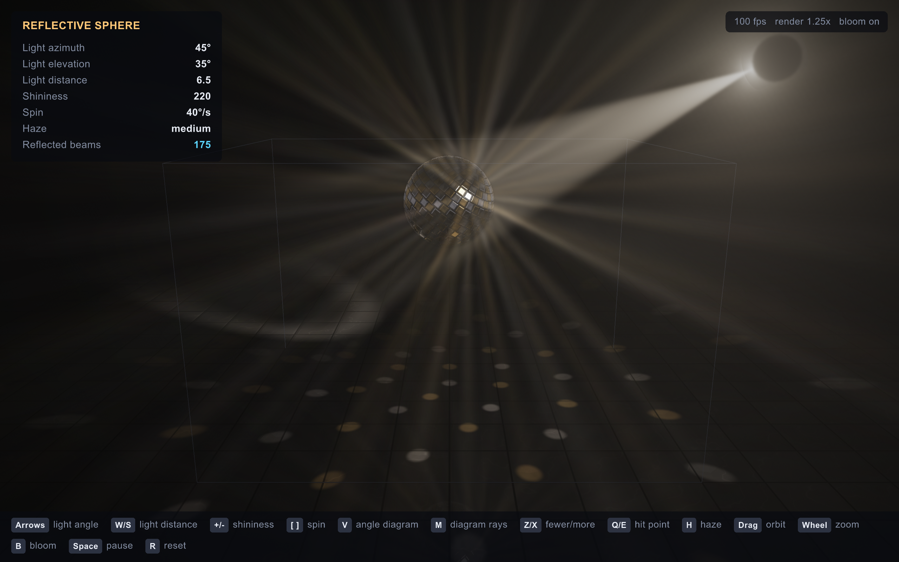
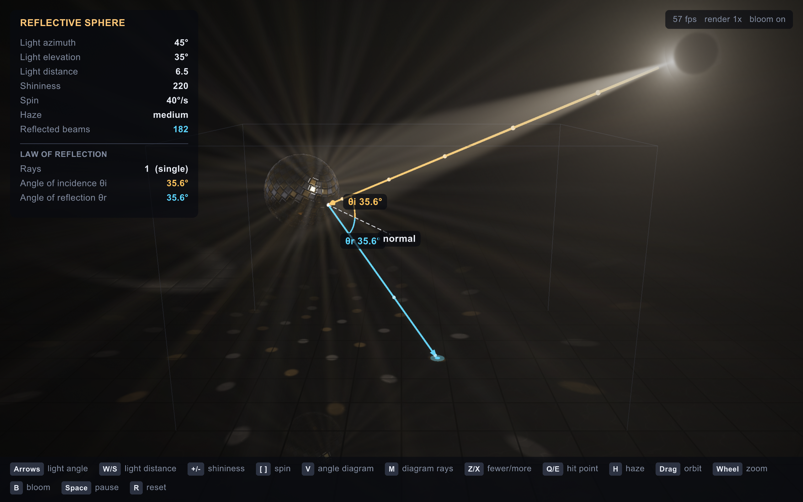

# Reflective Sphere (C#)

A 3D mirror ball that moves in x, y and z (bouncing inside a box) and spins on its own tilted
axis. A stage spotlight shines on it from an angle you choose, and the reflection is
**simulated as real light**: every flat mirror tile reflects a beam of the spotlight at the mirror
angle (angle of reflection = angle of incidence). The beams are visible in hazy air and land as
spots of light on the floor, sweeping around as the ball spins.

Built with .NET 8 and [Raylib-cs](https://github.com/ChrisDill/Raylib-cs) (OpenGL 3.3+).



## Run

```bash
dotnet run
```

Options: `--haze off|light|medium|thick`, `--rays single|fan|burst` (shows the angle diagram),
`--at 2.7` (start the motion that many seconds in), `--screenshot out.png`.

## Controls

| Key            | Action                                        |
|----------------|-----------------------------------------------|
| Left / Right   | Move the spotlight around (azimuth)           |
| Up / Down      | Raise / lower the spotlight (elevation)       |
| W / S          | Move the spotlight closer / further           |
| H              | Haze: off / light / medium / thick            |
| + / -          | Shininess (tighter / broader glints)          |
| [ / ]          | Spin speed                                    |
| V              | Show / hide the lines-and-angles diagram      |
| M              | Diagram rays: fan / 3D burst / single         |
| Z / X          | Fewer / more diagram rays                     |
| Q / E          | Move the diagram's highlighted ray            |
| Mouse drag     | Orbit camera                                  |
| Mouse wheel    | Zoom                                          |
| B              | Toggle bloom                                  |
| Space          | Pause                                         |
| R              | Reset motion                                  |
| Esc            | Quit                                          |

## The light simulation

**The mirror ball** (`FacetBall.cs`) is about 400 flat mirror tiles in rows, fewer near the
poles so each is roughly square, with a round tile capping each pole. Tiles are silver or gold
and glued very slightly unevenly, like a real ball. A smooth mirror sphere spreads reflected light
evenly in all directions, so no individual rays can be seen; flat tiles each send out a narrow
beam, which is what makes the reflected rays visible.

**The lamp** is a spotlight aimed at the ball, with a cone just wider than the ball, plus a
dim fill light so the room isn't black. Light falls off with distance squared.

**Reflected beams** (`LightSimulation.cs`), every frame, for every tile:

1. Find the light arriving: the spotlight's intensity towards the tile ÷ distance², times the
   tile's area × cos(angle of incidence).
2. Reflect it: `R = L − 2 (L·N) N` about the tile's normal, scaled by the mirror's reflectance
   (gold reflects less blue).
3. Spread it: the beam widens at the angle the lamp's lens subtends from the tile.
4. Follow it to the floor.

**What you see:**

- **Beams in the haze.** A beam's brightness is haze density × beam irradiance × the width of
  beam the eye looks through, so beams are brightest near the ball and dim as they widen. The haze
  scatters slightly forwards (Henyey-Greenstein), so beams heading towards the camera look
  brighter.
- **Spots on the floor.** Each beam's power is spread over its footprint (an ellipse when it
  arrives at a slant) and painted into a floor light map. The floor shader lights the tiles with
  it like any other light (dark grout stays dark), and the ball's own reflection of the floor
  shows the spots too.
- **The spotlight's beam** (`Shaders/haze.frag`) is light scattered by the haze, integrated
  along each view ray with equiangular sampling. The ball's shadow runs through it. It is computed
  at half resolution (haze is smooth) and blended over the image.
- **The ball itself** (`Shaders/sphere.frag`). Each tile mirrors the view ray and traces it into
  the scene: the lamp's lens, the lit floor with its spots, the glowing haze. A tile flashes when
  it lines up the lamp with your eye.

## The angle diagram (`ReflectionGuide.cs`)



Press **V** for a lines-and-angles overlay. It snaps to the real tiles, so its rays lie exactly on
simulated beams. At the highlighted tile it shows the incident ray, the normal and the reflected
ray, with θi and θr measured separately; they always come out equal. **M** switches between one
ray, a fan across the ball and a 3D burst.

## Rendering pipeline

1. **Floor light map**: the beams' landing spots, painted from above.
2. **Scene, supersampled** (`PostProcess.cs`): the studio backdrop, then the mirror image below the
   floor (ball, lamp and beams, shaded from a mirrored camera), then the polished floor (partly
   transparent where it reflects), the ball, the lamp and the beams.
3. **Haze glow** at half resolution, lightly blurred.
4. **Bloom**, vignette and dithering, then the HUD.

Resolution adapts to the machine: it starts at 2x supersampling (1.25x on Retina) and steps down,
to native (or 0.75x on Retina), if the frame rate stays under 55 fps. The HUD shows the current
`render` scale.
